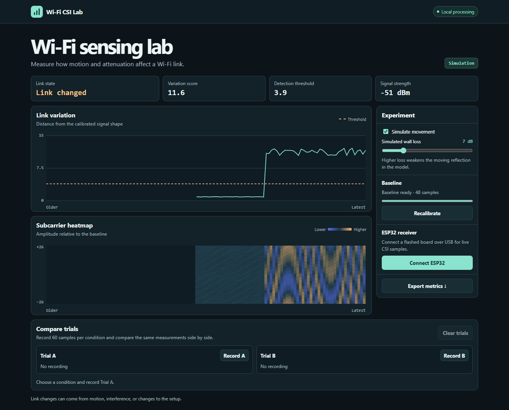

# Wi-Fi CSI Lab

Explore how movement and attenuation change the channel between a Wi-Fi transmitter and receiver. Use the synthetic simulation or read channel state information (CSI) from an original ESP32 board over USB.



## Simulation

The simulation combines a direct signal, fixed reflections, and an adjustable moving reflection across 51 subcarriers. Toggle **Simulate movement** and change **Simulated wall loss** to see how the link changes. The loss slider controls only the moving reflection. It is a model parameter, not a measurement of a particular wall material.

**Recalibrate** collects 48 samples while the setup is still. The analyzer normalizes each amplitude vector by its mean, uses the per-subcarrier median as the baseline, and compares subsequent vectors by their root-mean-square distance. A threshold derived from the median absolute deviation and consecutive-sample checks help reject brief changes. The chart uses sample order, so irregular hardware packet intervals are visible in exported elapsed times.

**Compare trials** records 60 scored samples per condition and displays mean variation, peak variation, samples above threshold, and elapsed sample time. Try recording at 7 dB and 24 dB with the simulated movement enabled. For a hardware trial, set up each condition, recalibrate while still, then use the same movement in both trials. A gap in the live stream cancels the recording. Trial results stay in the tab's memory.

The result is a link-variation signal. It cannot determine the number, identity, position, or posture of people or reconstruct an image. In a real experiment, interference and changes to the hardware or room can also alter the link. Use an area you control and make sure participants agree to the experiment.

## Run the viewer

From the project folder, use Python 3 to start a local static server:

```sh
python -m http.server 8000 --bind localhost
```

Open `http://localhost:8000` on the same device. The simulation needs no receiver. Live mode uses [Web Serial](https://developer.chrome.com/docs/capabilities/serial) in a compatible desktop browser such as Chrome.

## ESP32 experiment

The receiver source targets the **original ESP32**, such as an ESP32-WROOM-32 development board, with ESP-IDF 5.5.2. The firmware is experimental and needs verification on a physical board.

1. In an ESP-IDF terminal, go to `firmware`, select the `esp32` target, build, and flash the board.

   ```sh
   idf.py set-target esp32
   idf.py build
   idf.py flash
   ```

   If automatic port selection fails, specify the board's serial port with `idf.py -p PORT flash`. Close any serial monitor before opening the viewer.
2. Open the viewer locally and select **Connect ESP32**. Choose the board's USB port. The firmware opens an isolated **CSI-Lab** network and shows a temporary password through the viewer. Join that network from the Wi-Fi device you want to use as the transmitter.
3. On the connected device, run `python probe.py` from the project folder. It sends small UDP probes to the ESP32's default lab address, `192.168.4.1`. The network is standalone and provides no internet access. Press Ctrl+C to stop sending probes.
4. Leave both devices still while the 48-sample baseline is collected. Move between or near them and observe the chart. For a second run, place an obstruction in the link, keep the devices still, recalibrate, and repeat the same movement. Detection depends on the placement, attenuation, and interference.

The receiver limits capture to its associated lab peer and uses 20 MHz LLTF CSI. It skips guard bins, DC, and the first potentially invalid positive bin. The browser keeps recent samples in memory. CSV export includes elapsed time, RSSI, variation, threshold, and state. The export does not include the temporary network password, device addresses, packet payloads, or raw CSI.

## References

- [Espressif ESP32 CSI guide](https://docs.espressif.com/projects/esp-idf/en/v5.5.2/esp32/api-guides/wifi.html#wi-fi-channel-state-information-configure) explains the device's sample format.
- [WiTrack](https://witrack.csail.mit.edu/witrack-paper.pdf) describes a research system that uses FMCW ranging for 3D motion tracking.
- [Through-Wall Human Pose Estimation Using Radio Signals](https://openaccess.thecvf.com/content_cvpr_2018/html/Zhao_Through-Wall_Human_Pose_CVPR_2018_paper.html) describes radio-based pose estimation trained with synchronized visual data.

Licensed under [MIT](LICENSE).
